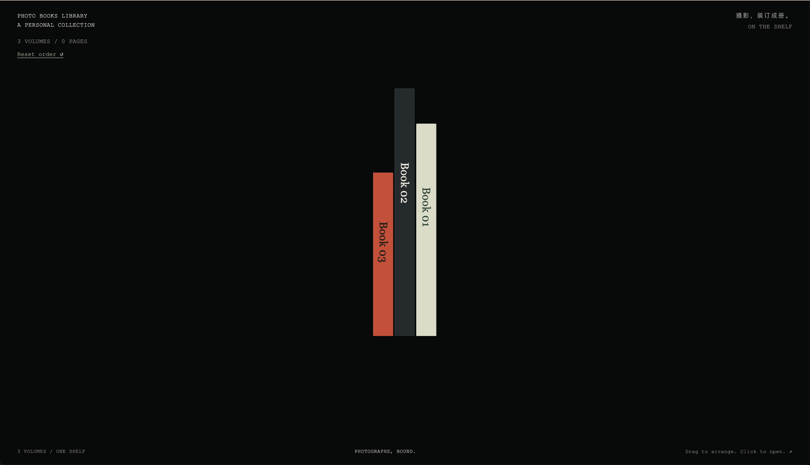
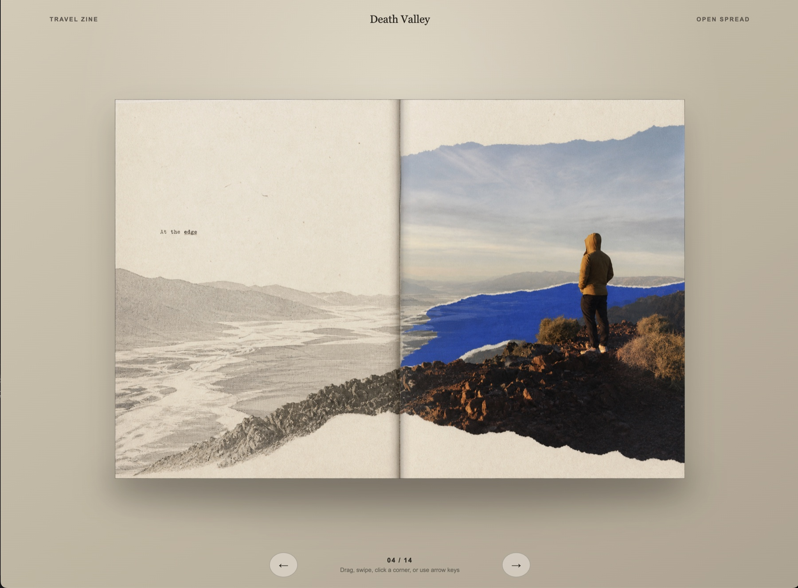
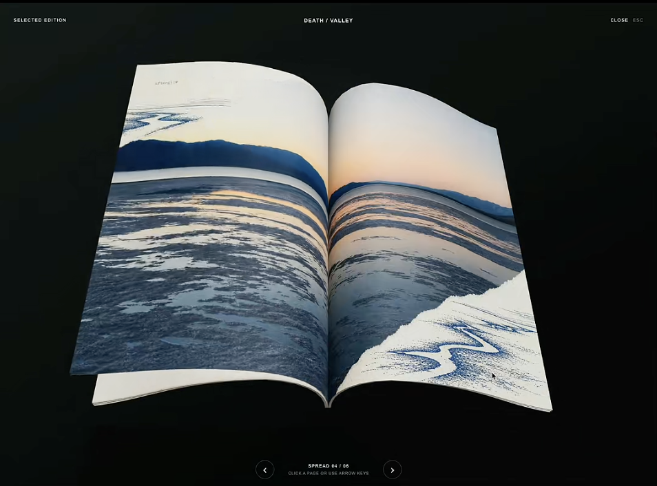
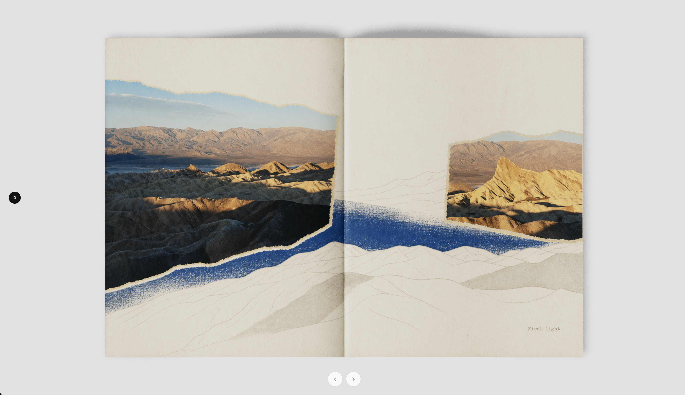
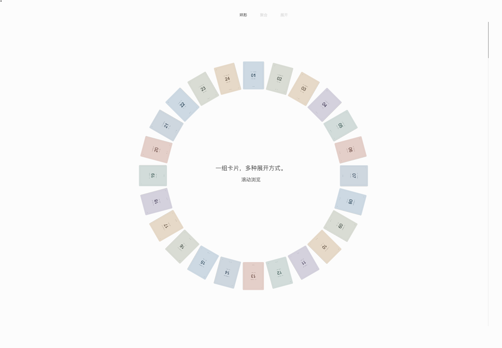
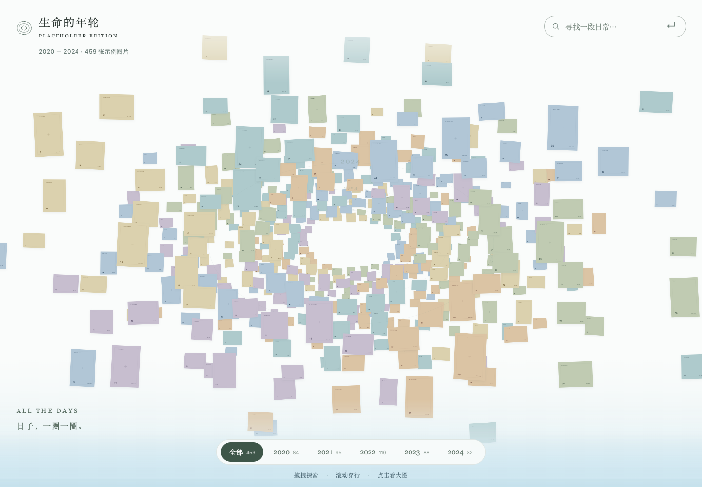
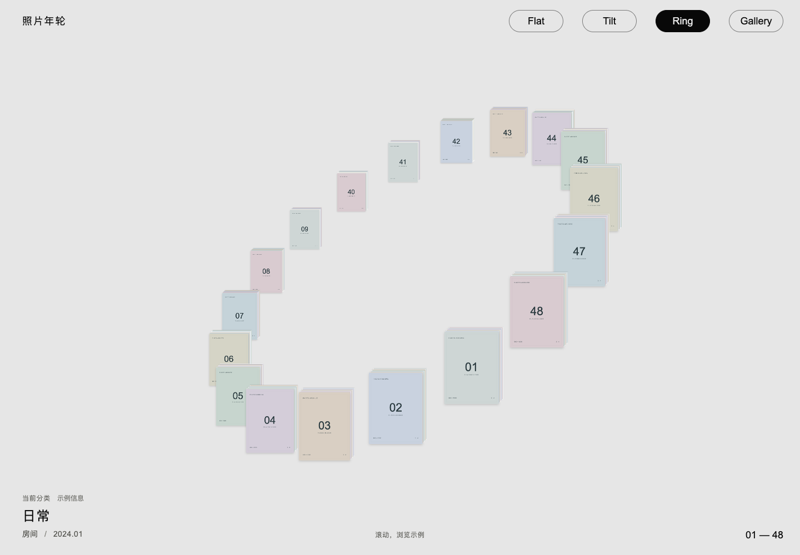

# [找作者定制 →](https://makehologram.com/)

Explore the platform for discovering and using new visual experiences.

# Create Photo Flipbook UI

**English** · [简体中文](README.zh-CN.md)

## [Visit the website →](https://haichaolihc.github.io/create-photo-flipbook-ui/)

Create a photo flipbook from your photos with a Codex skill that curates images, designs expressive photobook spreads, and builds an interactive page-turning website. The skill uses the bundled **3D hardcover book** runtime in [`assets/3d-book/`](skills/create-photo-flipbook-ui/assets/3d-book/).

The website supports English and Simplified Chinese. On the main URL, it uses your browser’s preferred supported language; the language switch remembers your choice. This README has a separate [Chinese translation](README.zh-CN.md).

The project website and GitHub Pages build live in [`website/`](website/). Reusable UI templates live separately in [`ui-collections/`](ui-collections/).

## UI collections

These templates live in `ui-collections/`, outside the skill folder, and are optional resources for people to copy and customize. They are not installed with the skill. The skill uses its own bundled 3D hardcover runtime; the library, 3D readers, film archive, spatial galleries, and photo stream are separate alternatives.

| [Library](ui-collections/library/) | [2D Book](ui-collections/2d-book/) |
| --- | --- |
|  |  |
| Reorderable shelf with three empty mock books. | Standalone 2D template; not included in the skill. |

| [3D Book 1](ui-collections/3d-book-1/) | [3D Book 2](ui-collections/3d-book-2/) |
| --- | --- |
|  |  |
| React and WebGL reader with curved pages and a dark stage. | Three.js and Quick FlipBook reader with a light stage and soft shadows. |

| [Card Gallery](ui-collections/card-gallery/) | [Image Atlas](ui-collections/image-atlas/) | [Photo Ring](ui-collections/photo-ring/) |
| --- | --- | --- |
|  |  |  |
| Scroll or drag cards through a ring, an arc, a stack, and an unfolded strip. | Explore a spatial archive of concentric year rings, with theme search and focused image browsing. | Switch between Flat, Tilt, Ring, and Gallery layouts while preserving your browsing position. |

These three galleries use vanilla HTML, CSS, and JavaScript with local SVG
placeholders and fictional sample content—no personal photographs or external
image requests. No install or build step is needed; see each linked README for
preview instructions and how to add your own images.

### [Stream / Undertow](ui-collections/stream-implement-3d/)


A waterfall of light, with a photo story flowing through every thread. Bring your own photos. [Setup →](ui-collections/stream-implement-3d/README.md)

## Install

```bash
python3 ~/.codex/skills/.system/skill-installer/scripts/install-skill-from-github.py \
  --repo HaichaoLihc/create-photo-flipbook-ui \
  --path skills/create-photo-flipbook-ui \
  --ref main
```

## Use

```text
Use $create-photo-flipbook-ui to turn these photographs into photobooks.
```

One workflow, four stages:

1. **Understand the photos:** their form, content, themes, and unexpected relationships. Semantic search and contact sheets are available.
2. **Explore creative directions:** develop distinct concepts for the theme, image presentation, motifs, material, typography, cover, and page turns; choose the strongest direction for the collection.
3. **Design and generate the spreads:** carry the selected concept through the sequence. Generate every complete spread with ImageGen using the selected photos as references, including the outside cover and all interior spreads.
4. **Build the UI:** split the generated artwork into facing leaves, present it with the built-in 3D hardcover runtime, and deliver a working local URL.

The agent chooses the art direction and sequence. ImageGen is required for every spread unless the user explicitly overrides that production method.

[Creative ideation](skills/create-photo-flipbook-ui/references/creative-ideation.md) explores possibilities before layouts are fixed. The [default editorial zine principles](skills/create-photo-flipbook-ui/references/default-style.md) combine recognizable photography, selective artistic transformation, purposeful page composition, and consistent typography. A small artistic vocabulary drawn from the photos develops across the book: some passages rest, others mix photography with cutouts, overprinting, drawing, or abstraction, and selected moments can transform more boldly. Ordinary middle pages should express this language too. Neither untouched photo boxes throughout nor continuous paintings on every turn establish the intended balance. Pale paper and a standard cover are not prescribed. [Book rhythm](skills/create-photo-flipbook-ui/references/book-rhythm.md) guides changes across page turns. Each run reviews the cover, quiet, impact, and representative middle pilots, then checks the complete book for artistic quality, continuity, and repetition. The reader displays complete generated artwork and ships without sample photographs. Creative directions, sequence plans, prompts, source associations, generated masters, and rhythm reviews remain with each output.

## Photo search and reusable code

The skill declares the existing `photo-search` MCP dependency for library search, ranked contact sheets, and larger previews. The MCP itself is read-only. The bundled `scripts/photo_library.py` adapter adds folder-specific cached indexes and semantic searches by reusing an installed photo-search engine's `index.py` and `PhotoSearchEngine`; it does not replace the connected MCP's global index.

Install the engine and its Python requirements separately, set `PHOTO_SEARCH_ENGINE_DIR` to its location, and use its Python interpreter. See [Photo library setup and commands](skills/create-photo-flipbook-ui/references/photo-library.md). Index caches remain outside the skill and source folders. New and changed images are embedded incrementally; unchanged images are reused. Search output includes a contact sheet and manifest, and selections retain stable IDs and original paths.

Reusable resources shipped with the skill include the photo-library adapter, ordered contact-sheet renderer and 3D hardcover book runtime. Art direction and sequencing remain in workflow instructions. Model weights and photo libraries are not part of the skill package.

See each template’s README for local preview instructions.

[Negative Sleeves](ui-collections/film-negative-flipbook/) is a separate, photo-free film archive
UI with page-corner previews, draggable film strips, reversible single-frame
inspection, and optional continuously paginated semantic search. Import a local
photo folder with its Python builder; generated books and photographs stay Git-ignored.

## Validate

```bash
python3 tests/validate_repo.py
```

[Evaluation guide](evals/README.md).

## License

Original project code and the installable skill are [MIT licensed](LICENSE). Third-party components retain their own licenses. The adapted code in `ui-collections/3d-book-1/` and all photographs, videos, and other media are excluded unless expressly stated otherwise.
